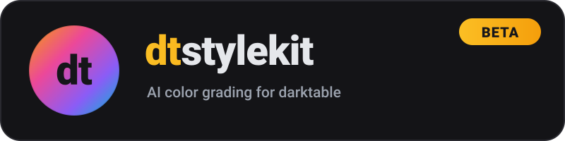
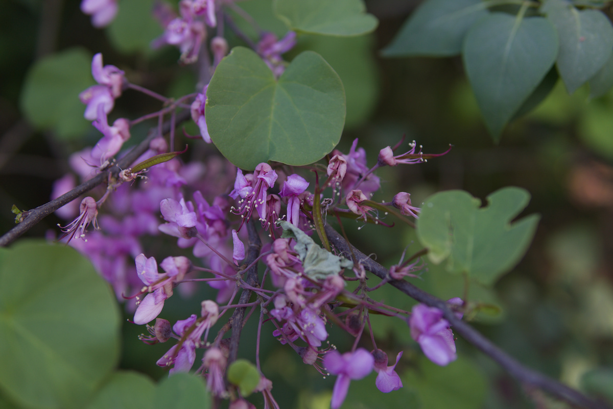
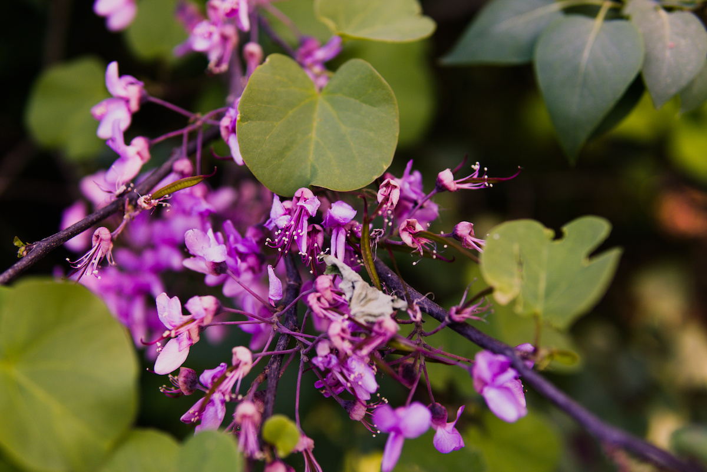

<p align="center">
  
</p>

# dtstylekit

**Turn the look of a photograph into a darktable style.**

dtstylekit is a command-line tool that looks at a photo (or a handful of reference photos), works out what makes the edit feel the way it does, and writes a ready-to-import `.dtstyle` file for [darktable](https://www.darktable.org/).

A local vision model does the "looking" and the proposing. It never invents the file format: it selects styles from the official darktable library and suggests small parameter adjustments, while the Python pipeline validates everything and serializes the final file. The result is a valid style plus a report explaining the choices.

## Before you start

**It's experimental.** This project grew out of reverse-engineering and a lot of iteration against the darktable source. It can fail, produce surprising results, or generate a style that doesn't look the way you expected. Review every result, keep backups, and don't drop it into a paid client workflow without checking the output first.

**Learn the technique, don't copy the photographer.** The point is to understand *how* a look is built — exposure, contrast, tonal color grading, saturation — not to clone someone's commercial work. If you love a photographer's style, buy their presets or their prints.

**Made for free software.** dtstylekit exists for the darktable community: editing RAW files openly and affordably, and learning color grading without license fees. If you like a look the style, support the person who made it.

## Quick start

You'll need **Python 3.11+**, **[Ollama](https://ollama.ai/)** running locally, and **darktable** on your `PATH`. dtstylekit calls `darktable-cli` to render RAW previews, apply styles, and run visual checks.

### 1. Install a vision model

Install Ollama from [ollama.ai](https://ollama.ai/) if you don't have it yet:

```bash
# Linux
curl -fsSL https://ollama.ai/install.sh | sh

# macOS
brew install ollama
```

On Windows, download the installer from [ollama.ai](https://ollama.ai/).

Start the service and pull the default model:

```bash
ollama serve            # usually starts automatically after install
ollama pull gemma3:27b
```

Check that it can see an image:

```bash
ollama run gemma3:27b "Describe this image" --image /path/to/photo.jpg
```

### 2. Install dtstylekit

From the project root:

```bash
python3 -m venv .venv
source .venv/bin/activate
pip install -e ".[dev]"
```

This registers the `dtstylekit` command. If the command isn't found later, make sure the virtual environment is still active. More help: [docs/troubleshooting.md](docs/troubleshooting.md).

### 3. Point it at your darktable styles

dtstylekit searches the **534 official darktable styles** that ship with darktable. Those files are not copied into this repository, so it needs to know where your darktable checkout lives.

The easy way:

```bash
./setup.sh
```

The script finds the style library, creates the `data/presets` symlink, checks that the files are reachable, and builds the search index. It's safe to run more than once.

Prefer to do it by hand?

```bash
git clone https://github.com/darktable-org/darktable /path/to/darktable
ln -s /path/to/darktable/data/styles data/presets
dtstylekit preset index
```

Or skip the symlink entirely and point dtstylekit straight at the styles:

```bash
export DTSTYLEKIT_PRESETS_DIR=/path/to/darktable/data/styles
```

> `data/presets` is just a pointer to your local darktable checkout. It's machine-specific and gitignored, which is why it isn't part of the repo.

### 4. Generate a style

```bash
dtstylekit generate photo.jpg -o my_style.dtstyle
```

RAW files work too. dtstylekit renders a JPEG preview for the model and tests the resulting style against the RAW itself:

```bash
dtstylekit generate photo.ARW -o my_style.dtstyle
```

## Common commands

| Command | What it does |
|---|---|
| `dtstylekit generate` | Analyze a photo and write a `.dtstyle` file |
| `dtstylekit apply` | Apply a style to a set of photos, normalizing exposure per image |
| `dtstylekit preset list` | List the indexed presets |
| `dtstylekit preset search "warm cinematic"` | Search presets by description |
| `dtstylekit preset index` | Rebuild the preset search index |
| `dtstylekit curves` | Work with curve-based adjustments (tone curve, RGB curve, color zones) |

A few examples:

```bash
# Derive a look from reference photos and write a Spanish explanation
dtstylekit generate photo.jpg \
  --references 'refs/*.jpg' \
  --direction "cinematic warm portrait" \
  --lang es

# Keep only references that share the same edit (the default policy)
dtstylekit generate photo.jpg --references 'refs/*.jpg' --reference-filter auto

# Use a different vision model
dtstylekit generate photo.jpg --model llama3.2-vision:11b -o my_style.dtstyle

# Apply a style to a whole set, using references to set the target exposure
dtstylekit apply my_style.dtstyle 'photos/*.ARW' \
  --references 'refs/*.jpeg' -o outputs/
```

Styles are **exposure-neutral**: `generate` saves the look, and `apply` calculates an exposure offset for each photo. That way a style made from one frame won't blow out brighter frames in the same set.

### Choosing a model

The default is `gemma3:27b`. Any vision model available in Ollama will work:

| Model | Flag | Approximate VRAM |
|---|---|---|
| Gemma 3 27B (default) | `--model gemma3:27b` | 16 GB |
| Llama 3.2 Vision 11B | `--model llama3.2-vision:11b` | 8 GB |
| Gemma 3 4B | `--model gemma3:4b` | 4 GB |
| LLaVA 7B | `--model llava:7b` | 6 GB |

## How it works

1. The image analyzer measures exposure, luminance, contrast, noise, EXIF data and scene characteristics.
2. The preset index searches the official darktable styles for the closest semantic matches.
3. The vision model describes the look, chooses 1–3 presets, and proposes small scalar changes on verified modules (`filmicrgb`, `colorbalancergb`, `sigmoid`, `exposure`, `atrous`).
4. A validator and safety pass clamp values and reject anything outside the supported layouts.
5. The composer serializes a valid `.dtstyle` and writes the accompanying report.

## What you get

Each run produces:

- **A `.dtstyle` file** ready to import into darktable.
- **A markdown report** explaining the preset selection, parameter choices, expected visual effect, and — when references are used — the reference consistency decision.
- **A `*_EXPLICACION.md` document** when `--references` is passed. This is a plain-language narrative that analyzes the reference photos (tonal key, contrast, saturation, white balance, per-zone hue grading) and explains how the style was built. Choose the language with `--lang es` (default) or `--lang en`.

## Example results

Here's a real end-to-end run: the same RAW file rendered through `darktable-cli` with no style (left) and with a style generated from reference images (right).

| Before — no style | After — `Night_Market_Moody` |
|---|---|
|  |  |

That style came from:

```bash
dtstylekit generate photo.jpg \
  --references 'refs/*.jpg' \
  --direction "night market moody" --lang es
```

The model picked presets from the indexed library, the composer swapped `filmicrgb` for `sigmoid` to avoid crushing the shadows, and the final render matched the tonal key and color grading of the references.

## Supported darktable versions

The binary layouts (IOP struct versions, blendop version, `module` fields) are tied to a specific darktable build. This checkout targets the darktable master that contains `dtstylekit/`. If you update darktable, run the drift checks first:

```bash
pytest tests/test_version_drift.py tests/test_real_presets.py
```

- `test_version_drift.py` compares the module registry against `DT_MODULE_INTROSPECTION` in the enclosing checkout's `src/iop/*.c` and fails if they drift apart.
- `test_real_presets.py` re-checks blob sizes against the official styles in `data/styles/`.

## Visual smoke check

Passing structural validation (valid XMP, correct blob sizes) proves a style *imports*, not that it *looks right*. After generating one, render a test image with and without it:

```bash
python tools/visual_check.py --style generated_styles/my_style.dtstyle
```

The script uses `darktable-cli` to render a deterministic synthetic image and fails on near-black, near-white, or flat output. It needs `darktable-cli` on `PATH`; tests skip it automatically when it isn't available.

## Configuration

Paths can be overridden with environment variables, which is useful when running dtstylekit from another directory or keeping large files on a different disk:

| Variable | Default | Purpose |
|---|---|---|
| `DTSTYLEKIT_PRESETS_DIR` | `data/presets` | Where the `.dtstyle` library lives |
| `DTSTYLEKIT_OUTPUTS_DIR` | `outputs/` | SQLite index and embeddings |
| `DTSTYLEKIT_GENERATED_DIR` | `generated_styles/` | Generated styles and reports |

## Development

```bash
pytest                  # run the test suite
ruff check .            # lint (CI enforces a clean run)
mypy dtstylekit --follow-imports=skip --ignore-missing-imports   # type check (best effort)
```

The codebase still carries some typing debt, so a fully clean `mypy` run isn't expected yet.

## Project layout

```text
dtstylekit/
├── cli.py                 # Command-line entry point
├── paths.py               # Project-root and environment path resolution
├── codec/                 # XMP codec, blendop blobs, IOP registry, serializer
├── presets/               # Preset parser, SQLite index, embeddings, search
├── analyzer/              # Histogram, EXIF, luminance, noise and scene analysis
├── vlm/                   # Prompts, Ollama client, orchestration, validation
├── composer/              # Style generation, merging, reports, round-trip checks
├── curves/                # Curve templates and pack/unpack support
└── data/presets/          # Symlink to the official darktable style library
```

More detail: [docs/architecture.md](docs/architecture.md), [docs/advanced_usage.md](docs/advanced_usage.md), and [docs/quick_reference.md](docs/quick_reference.md).

## Contributing

This repository is the release channel. Day-to-day development happens in a private working copy inside a darktable checkout, where the tools can read the darktable C sources directly. Changes are synced here as reviewed commits.

- **Bug reports and feature requests** are very welcome — open an [issue](https://github.com/Dhurzo/Darktable-Styles-Kit/issues).
- **Small pull requests** (typos, docs) are fine. For larger changes, please open an issue first so we can agree on the approach.
- CI runs the full test suite against a sparse darktable checkout on every push and pull request, so `main` stays usable on its own.

## License

MIT — see [LICENSE](LICENSE).

## Acknowledgements and legal notes

- Built for and around [darktable](https://www.darktable.org/). This project is **not affiliated with, endorsed by, or connected to** the darktable project or its maintainers. "darktable" is used descriptively.
- The official style library (534 `.dtstyle` files) is **not redistributed**. You link your own darktable checkout, and all credit for those styles belongs to the darktable contributors.
- No photographers' photographs are included in this repository.
